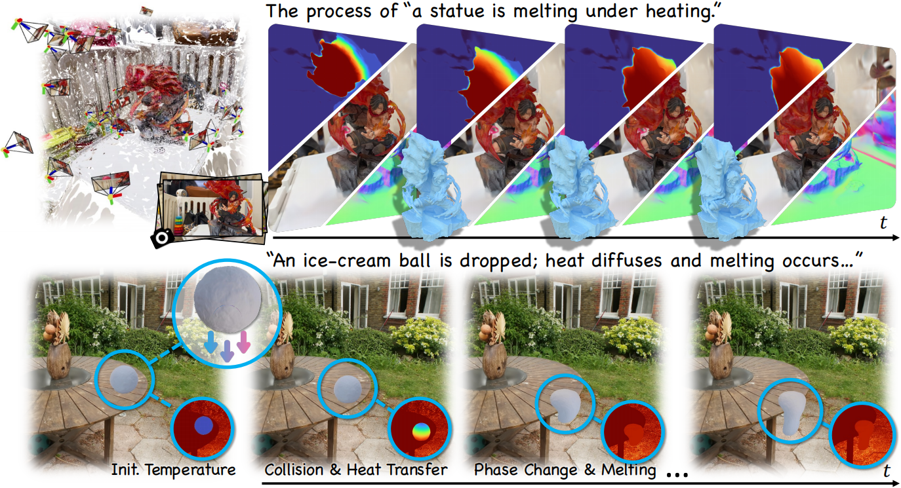
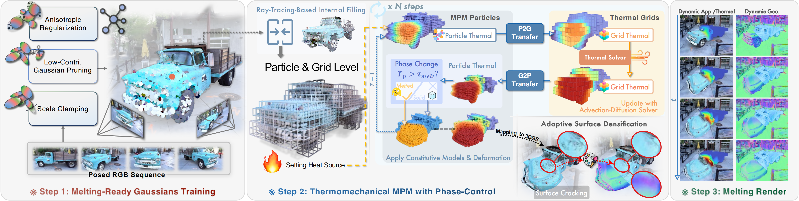

<div align="center">

<h3>
  <br>
  MeGAS: Thermomechanical Dynamic Gaussian Splatting<br>for Thermophysical Scene Editing
</h3>

**ECCV 2026**

[Zesong Yang](https://github.com/YZsZY)<sup>&#42;</sup>, [Yuanhang Lei](https://github.com/huahuo359)<sup>&#42;</sup>, [Liyuan Cui](https://scholar.google.com/citations?user=WhwTrhcAAAAJ&hl=zh-CN), [Yihang Chen](https://sh17c.top/), [Jiaer Huang](https://github.com/Shallowy),<br>
[Boming Zhao](https://bomingzhao.github.io/), [Peter Yichen Chen](https://peterchencyc.com/), [Hujun Bao](http://www.cad.zju.edu.cn/home/bao), [Zhaopeng Cui](https://zhpcui.github.io)<sup>†</sup>

[](https://zju3dv.github.io/MeGAS/)
[](https://zju3dv.github.io/MeGAS/sources/pdf/ECCV26-MeGAS.pdf)
[](https://arxiv.org/abs/2606.23455)
[](https://www.youtube.com/watch?v=wAaGvaGSkGU)
[](https://github.com/NVIDIA/warp)
[](LICENSE)

[News](#-news) · [Overview](#-overview) · [Method](#-method-overview) · [Installation](#-installation) · [Usage](#-usage) · [Citation](#-citation)

</div>

## 📰 News

- **[2026-10-30]** MeGAS is now featured in [PhysStudio](https://github.com/zju3dv/PhysStudio#megas), our open-source world simulator for physics-based animation. 🌏
- **[2026-10-08]** The MeGAS simulation code and interactive viewer are now available! Welcome to try them out and share your feedback.
- **[2026-06-17]** MeGAS has been accepted to **ECCV 2026**! 🎉

<p align="center">
  
</p>

## ✨ Overview

Recent advances integrate physically grounded Newtonian dynamics with neural rendering frameworks, narrowing the gap between photorealistic scene reconstruction and physics-based animation. However, existing approaches focus on mechanically driven dynamics while neglecting temperature, a fundamental yet invisible physical factor underlying phenomena such as melting, solidification, and other thermomechanical processes.

In this paper, we propose MeGAS, a novel framework that incorporates thermomechanical phase-change dynamics into 3D Gaussian Splatting (3DGS). Specifically, we propose a new thermomechanical dynamic Gaussian Splatting representation that augments 3DGS with temperature attributes and employs a heat advection-diffusion solver with MPM dynamics incorporating phase transitions, enabling physically plausible and visually realistic synthesis of thermophysical phenomena.

Furthermore, a new topology-adaptive Gaussian rendering strategy is proposed to mitigate cracking and floaters under extreme deformation. Extensive experiments demonstrate that MeGAS produces physically consistent thermomechanical behavior while maintaining high-fidelity photorealistic rendering, advancing toward physics-integrated world models.

## 🔬 Method overview

<p align="center">
  
</p>

## 🛠️ Installation

Tested with **PyTorch 2.0 · CUDA 12.4 · NVIDIA Warp 1.7.2** on an **NVIDIA RTX 4070 Ti (12 GB)**. After installing PyTorch:

```bash
bash run_install.sh
```

## 🚀 Usage

**Simulation.** The input Gaussians are expected at `log/gaussians/<scene>/align/align_gaussian.ply`.

```bash
bash scripts/1_run_candy_house.sh
```

Results are written to `log/gaussians/candy_house/mpm/solid-jelly_liquid-foam_thermal-sphere/test/@<timestamp>/`.

**Interactive viewer.** Set `--mpm_path` to the output directory above:

```bash
python gs_simulation_gui.py --mpm_path log/gaussians/candy_house/mpm/solid-jelly_liquid-foam_thermal-sphere/test/@<timestamp>
```

## 📄 License

Original MeGAS code is licensed under [Apache 2.0](LICENSE).
Third-party components retain their respective licenses.

## 🙏 Acknowledgements

Parts of this code are adapted from [PhysGaussian](https://github.com/XPandora/PhysGaussian) and [Warp-MPM](https://github.com/zeshunzong/warp-mpm). We thank their authors for making these valuable resources available.

## 📝 Citation

If you find this work useful for your research, please consider citing:

```bibtex
@inproceedings{yang2026megas,
  title={MeGAS: Thermomechanical Dynamic Gaussian Splatting for Thermophysical Scene Editing},
  author={Yang, Zesong and Lei, Yuanhang and Cui, Liyuan and Chen, Yihang and Huang, Jiaer and Zhao, Boming and Chen, Peter Yichen and Bao, Hujun and Cui, Zhaopeng},
  booktitle={European Conference on Computer Vision},
  pages={390--409},
  year={2026},
  organization={Springer}
}
```
